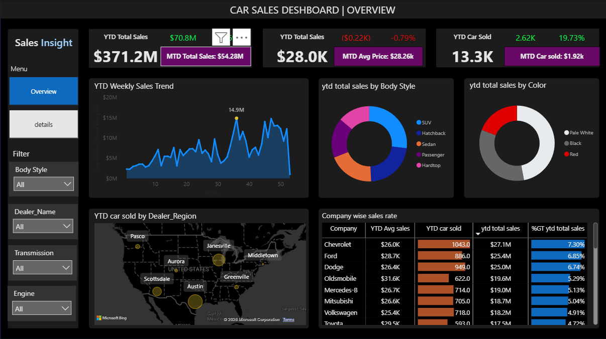
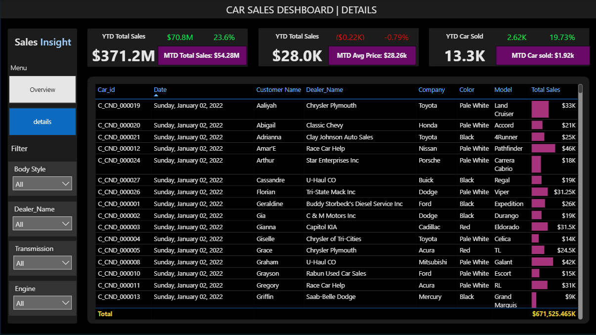

# Car Sales Performance & Analytics Dashboard (Power BI)

## Executive Summary
This project delivers a comprehensive, interactive **Car Sales Analytics Dashboard** built using **Power BI** to track automotive sales performance, year-over-year (YOY) growth trends, dealer regional distributions, and company-wise metrics. The dashboard is designed to provide executive stakeholders and sales managers with deep insights into revenue drivers, pricing strategies, and volume trends.

---

## Key Performance Indicators (KPIs)
- **YTD Total Sales:** $371.2M (+70.8M / +23.59% vs PTYD) | *MTD Total Sales: $54.28M*
- **YTD Average Price:** $28.0K (-$0.22K / -0.79% vs PTYD) | *MTD Average Price: $28.26K*
- **YTD Cars Sold:** 13.3K (+2.6K / +24.57% vs PTYD) | *MTD Cars Sold: 1.92K*

---

## Key Business Requirements & Insights

### 1. Sales & Pricing Overview
- **Sales Growth:** Achieved strong YOY revenue growth of **+23.59%**, crossing **$371.2M** in total year-to-date sales.
- **Volume vs Pricing Balance:** While total cars sold increased significantly by **24.57%** (reaching 13.3K units), the average price experienced a slight adjustment down to **$28.0K**, indicating higher volume movement in mid-tier vehicle segments.

### 2. Trends & Product Preferences
- **Weekly Sales Trend:** Fluctuates dynamically across weeks, with peak performance spikes reaching up to **$15.5M** in specific periods.
- **Body Style & Color Distribution:** SUVs and Sedans lead the market share by body style, while specific neutral and vibrant color profiles dominate buyer preferences as visualized in the distribution charts.

### 3. Geographic & Company Performance
- **Dealer Region Analysis:** Map-based visualization highlights sales density and performance across major US dealer hubs (such as Austin, Aurora, Pasco, and Janesville).
- **Company-Wise Grid:** Detailed breakdown mapping companies (e.g., Volvo, Volkswagen, Toyota, Ford) by their YTD average price, cars sold, total sales, and percentage contribution to overall revenue.

---

## Tech Stack & Methodology
- **Data Visualization & BI:** Power BI Desktop
- **Data Modeling & Analytics:** DAX (Data Analysis Expressions) for complex calculations (YTD, MTD, YOY growth, and variance metrics)
- **Data Transformation & ETL:** Power Query for data cleaning, modeling relational schemas, and handling date tables
- **Features Included:** Dynamic page navigation (Dashboard vs. Detailed Grid view), interactive filters (Body Style, Dealer Name, Transmission, Engine), and conditional formatting.

---

## Dashboard Preview

### View 1: Executive Overview & Visual Analytics

### View 2: Detailed Transactional Data Grid

---

## Strategic Recommendations
1. **Focus on High-Volume Brands:** Capitalize on top-performing manufacturing companies (such as Volkswagen and Toyota) by negotiating bulk inventory allocations.
2. **Regional Targeted Campaigns:** Deploy localized marketing incentives in underperforming dealer regions to boost regional turnover.
3. **Pricing Strategy Adjustment:** Balance the high-volume sales velocity of mid-priced vehicles with targeted promotions on luxury/higher-margin models to optimize average selling price (ASP).
